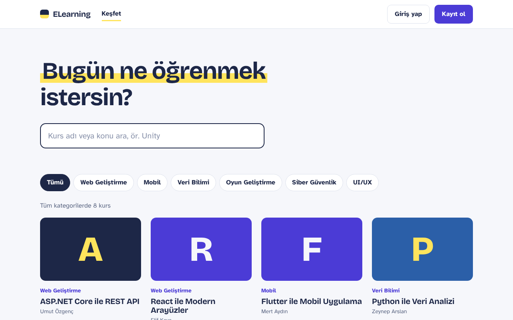
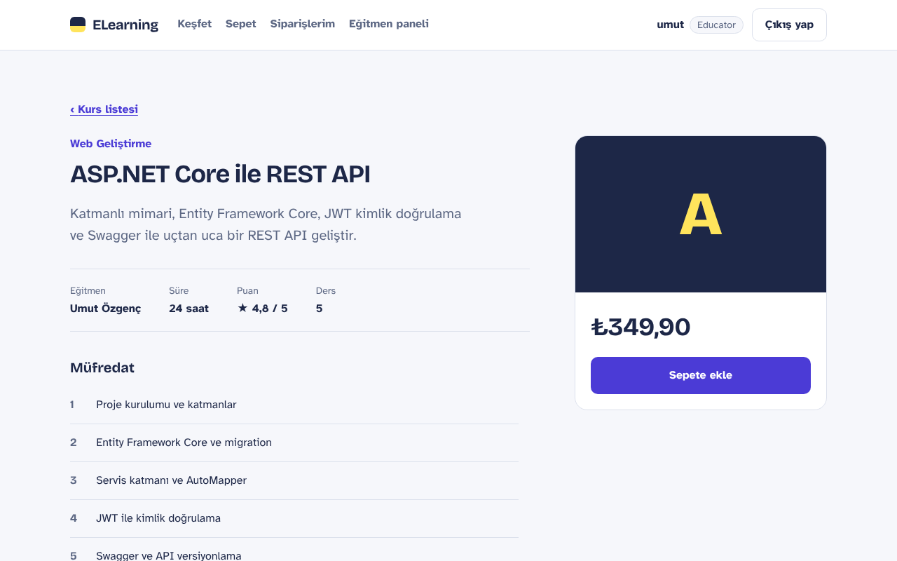
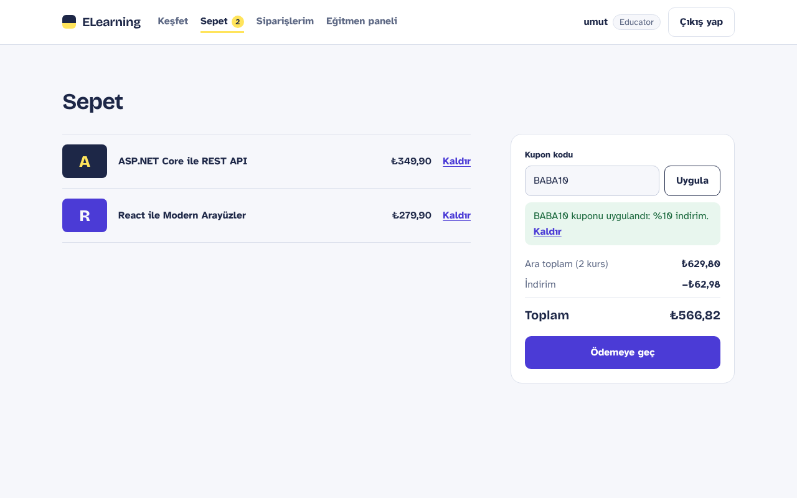
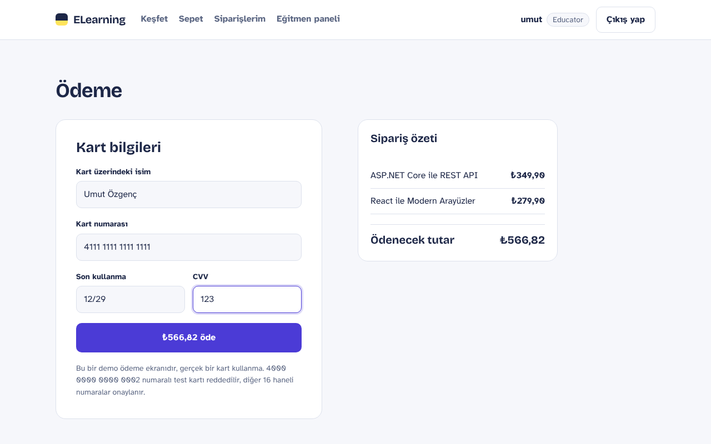
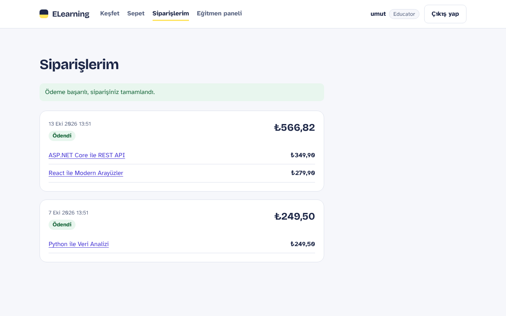
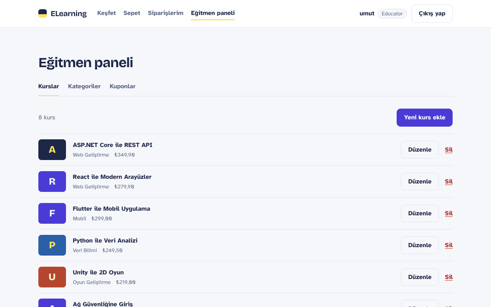
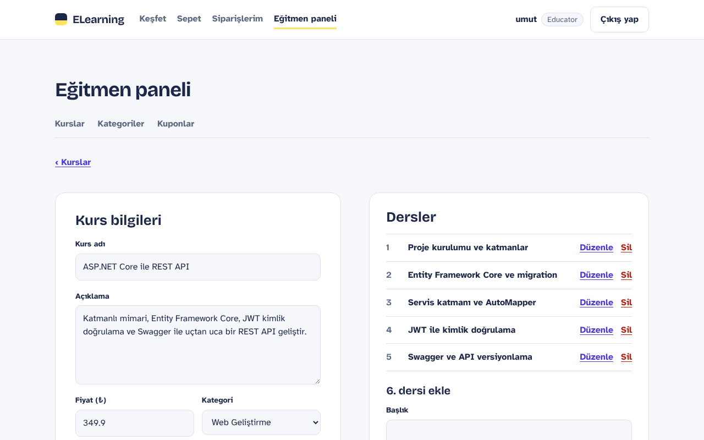
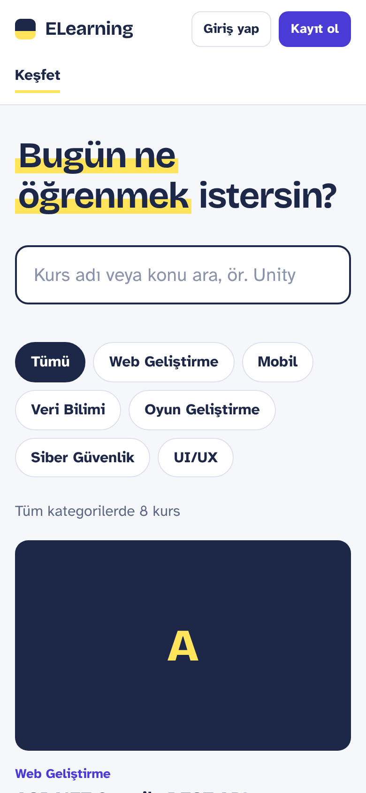
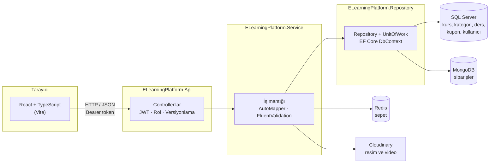
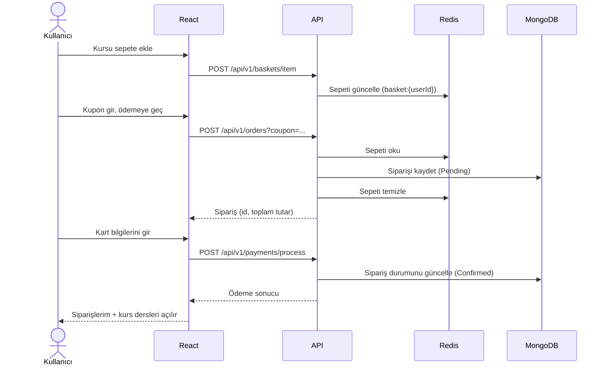

# ELearning Platform

Öğrencilerin kurs satın alıp derslerini izleyebildiği, eğitmenlerin kendi kurslarını ve derslerini yönetebildiği bir e-öğrenme platformu. Backend **ASP.NET Core 8 Web API**, frontend **React + TypeScript** ile geliştirildi.


---

## Ekran görüntüleri

| Kurs kataloğu | Kurs detayı ve müfredat |
| --- | --- |
|  |  |

| Sepet ve kupon | Ödeme |
| --- | --- |
|  |  |

| Siparişlerim | Eğitmen paneli |
| --- | --- |
|  |  |

| Kurs ve ders yönetimi | Mobil görünüm |
| --- | --- |
|  |  |

---

## Kullanılan teknolojiler

### Backend

| Teknoloji | Sürüm | Projedeki kullanımı |
| --- | --- | --- |
| .NET / ASP.NET Core Web API | 8.0 | REST API, controller tabanlı uç noktalar |
| Entity Framework Core (SQL Server) | 8.0.8 | Kurs, kategori, ders, kupon ve kullanıcı verileri; code-first migration |
| ASP.NET Core Identity | 8.0.8 | Kullanıcı ve rol yönetimi (`Admin`, `Educator`, `User`) |
| JWT Bearer Authentication | 8.0.8 | Token tabanlı kimlik doğrulama ve rol bazlı yetkilendirme |
| MongoDB.Driver | 3.1.0 | Siparişlerin doküman olarak saklanması |
| StackExchange.Redis (`IDistributedCache`) | 8.0.10 | Kullanıcıya özel sepetin önbellekte tutulması |
| CloudinaryDotNet | 1.26.2 | Kurs kapak resimlerinin ve ders videolarının yüklenmesi |
| AutoMapper | 13.0.1 | Entity ↔ DTO dönüşümleri |
| FluentValidation | 11.3.0 | İstek modellerinin doğrulanması |
| Asp.Versioning | 8.1.0 | URL tabanlı API versiyonlama (`/api/v1/...`) |
| Swashbuckle (Swagger) | 6.4.0 | API dokümantasyonu ve JWT ile deneme arayüzü |
| NUnit + Moq | 3.14 / 4.20 | Servis katmanı birim testleri |
| Docker Compose | – | SQL Server 2022 ve Redis konteynerleri |

### Frontend

| Teknoloji | Projedeki kullanımı |
| --- | --- |
| React 19 + TypeScript | Bileşen tabanlı arayüz, tip güvenli API modelleri |
| Vite | Geliştirme sunucusu, üretim derlemesi ve API'ye proxy |
| React Router 7 | Sayfa yönlendirme, korumalı ve role özel rotalar |
| Axios | API istemcisi, token ekleyen ve 401'de oturumu kapatan interceptor'lar |
| Context API | Oturum (`AuthProvider`) ve sepet (`BasketProvider`) durumu |
| Saf CSS (design token'ları) | Renk, tipografi ve boşluk değişkenleriyle tutarlı, mobil uyumlu tasarım |
| Fontsource | Bricolage Grotesque ve Atkinson Hyperlegible yazı tipleri |
| oxlint | Kod kalitesi kontrolü |

---

## Mimari

### Genel görünüm



### Katmanlar

Çözüm, sorumlulukları birbirinden ayrılmış katmanlı (N-Layer) bir yapıdadır:

```
ELearningPlatform.sln
├── Core                         Ortak altyapı
│   ├── Repositories             Generic repository (IGenericRepository<TEntity, TId>)
│   ├── Response                 ServiceResult / ServiceResult<T> standart yanıt modeli
│   ├── Infrastructures          Cloudinary servisi
│   ├── Services                 IdentityService (token'dan kullanıcı bilgisi)
│   ├── Extensions               Ortak servis kayıtları, API versiyonlama
│   ├── Configuration            .env dosyasını okuyan yapılandırma yükleyici
│   └── Constants                Rol sabitleri
├── ELearningPlatform.Model      Entity'ler ve DTO'lar
├── ELearningPlatform.Repository DbContext, entity konfigürasyonları, migration'lar,
│                                repository'ler, UnitOfWork, audit interceptor, seed data
├── ELearningPlatform.Service    İş kuralları, validator'lar, AutoMapper profilleri
├── ELearningPlatform.Api        Controller'lar, kimlik doğrulama, Swagger, hata yönetimi
├── Service.Test                 Servis katmanı birim testleri
└── frontend                     React uygulaması
```

**Api** katmanı sadece HTTP ile ilgilenir: isteği alır, servisi çağırır ve `CustomBaseController` üzerinden `ServiceResult`'ı uygun HTTP durum koduna çevirir.

**Service** katmanı iş kurallarını içerir ve her işlemin sonucunu başarı ya da hata mesajlarıyla birlikte `ServiceResult` olarak döner. Böylece tüm uç noktalar aynı yanıt biçimini kullanır:

```json
{ "data": { }, "errorMessage": null, "message": null }
```

**Repository** katmanı veri erişimini soyutlar. SQL Server tarafında generic repository ve UnitOfWork deseni kullanılır. Siparişler için MongoDB'ye özel bir repository vardır.

### Veri depolama tercihleri

| Veri | Depolama | Neden |
| --- | --- | --- |
| Kurs, kategori, ders, kupon, kullanıcı | SQL Server (EF Core) | İlişkisel veri, tutarlılık, Identity entegrasyonu |
| Sepet | Redis | Geçici, kullanıcıya özel, hızlı okuma/yazma (`basket:{userId}`) |
| Sipariş | MongoDB | Sipariş anındaki kurs adı ve fiyatıyla birlikte tek doküman olarak saklanır |
| Resim ve video | Cloudinary | Dosya depolama ve CDN üzerinden sunum |

### Satın alma akışı



### Kimlik doğrulama ve yetkilendirme

- Kullanıcılar ASP.NET Core Identity ile kaydolur; kayıt sırasında **Öğrenci (User)** veya **Eğitmen (Educator)** rolü seçilir.
- Giriş yapıldığında API, kullanıcı Id'si, adı ve rollerini içeren bir **JWT** üretir.
- Uç noktalar `[Authorize]` ve `[Authorize(Roles = ...)]` ile korunur:
  - Katalog ve kurs detayı herkese açıktır.
  - Sepet, sipariş ve ödeme giriş gerektirir; kullanıcı yalnızca kendi sepetine ve siparişlerine erişebilir.
  - Kurs, ders, kategori ve kupon yönetimi `Educator` ve `Admin` rollerine açıktır.
  - Kullanıcı yönetimi yalnızca `Admin` rolüne açıktır.
- Frontend'de token tarayıcıda saklanır, her isteğe Axios interceptor'ı ile eklenir. Rotalar `RequireAuth` ve `RequireRole` bileşenleriyle korunur.

### Altyapı detayları

- **Yapılandırma:** Bağlantı cümleleri ve API anahtarları kaynak kodda değil, proje kökündeki `.env` dosyasında tutulur. `DotEnv` yükleyicisi bu değerleri ortam değişkeni olarak .NET yapılandırmasına aktarır. Docker Compose da aynı dosyayı kullanır.
- **Doğrulama:** FluentValidation kuralları otomatik çalışır; hatalar `ServiceResult` biçiminde döner.
- **Hata yönetimi:** Global exception handler, beklenmeyen hataları da aynı JSON biçiminde döndürür.
- **Audit:** `AuditDbContextInterceptor`, `IAuditEntity` uygulayan entity'lerin `Created` ve `Updated` alanlarını otomatik doldurur.
- **Seed data:** Uygulama açılırken bekleyen migration'lar uygulanır; roller, örnek kategoriler, kurslar, dersler ve kuponlar eklenir. `.env` ile isteğe bağlı bir Admin kullanıcısı oluşturulabilir.
- **Versiyonlama:** Tüm uç noktalar `/api/v{version}/[controller]` biçimindedir.
- **Swagger:** Geliştirme ortamında `/swagger` adresinde, JWT ile korumalı uç noktaları denemek için "Authorize" desteğiyle sunulur.
- **CORS ve proxy:** Frontend geliştirme sunucusu `/api` isteklerini Vite proxy'si ile API'ye yönlendirir; API ayrıca yapılandırılabilir CORS politikasıyla frontend adresine izin verir.

### Frontend yapısı

```
frontend/src
├── api/          Axios istemcisi ve uç nokta modülleri (auth, courses, basket, orders, panel...)
├── auth/         AuthProvider, useAuth, RequireAuth, RequireRole, token saklama
├── basket/       BasketProvider ve useBasket (sepet durumu ve üst menüdeki sayaç)
├── components/   Layout, CourseCard, CourseCover, ErrorList, OrderStatusBadge
├── hooks/        useOwnedCourseIds (satın alınan kurslar)
├── pages/        Katalog, kurs detayı, sepet, ödeme, siparişler, giriş, kayıt
│   └── panel/    Eğitmen paneli: kurs, ders, kategori ve kupon yönetimi
├── styles/       Design token'ları ve global stiller
└── utils/        Para birimi ve tarih biçimlendirme (tr-TR)
```

| Sayfa | Rota | Erişim |
| --- | --- | --- |
| Kurs kataloğu (kategori filtresi, arama) | `/` | Herkes |
| Kurs detayı, müfredat, ders oynatıcı | `/kurs/:id` | Herkes (dersler satın alanlara açık) |
| Giriş / Kayıt | `/giris`, `/kayit` | Herkes |
| Sepet | `/sepet` | Giriş yapmış kullanıcı |
| Ödeme | `/odeme/:orderId` | Giriş yapmış kullanıcı |
| Siparişlerim | `/siparisler` | Giriş yapmış kullanıcı |
| Eğitmen paneli | `/panel/...` | Educator, Admin |
